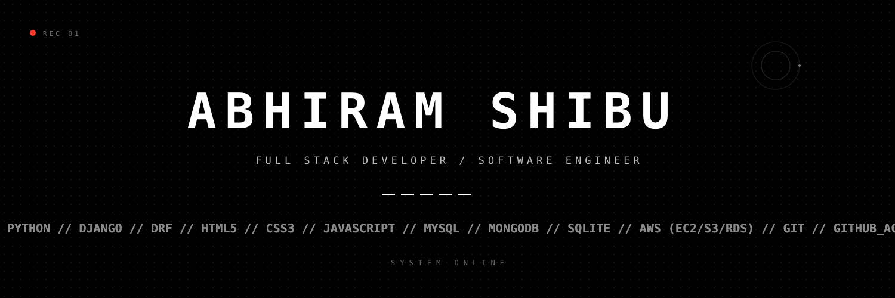

 

  

## About Me

I'm a Full-Stack Developer focused on building practical web and desktop applications. I work primarily with Python, Django, JavaScript, and MySQL, with experience in REST APIs, cloud deployment, and application development from backend to frontend.

- BCA graduate from STAS Pullarikkunu
- Experience building multi-vendor platforms and role-based applications
- Familiar with deploying applications using AWS, Nginx, and Gunicorn
- Currently developing **Balance**, a Windows digital wellbeing application

## Skills

| Area | Technologies |
|---|---|
| **Frontend** | HTML5, CSS3, JavaScript, Bootstrap 5 |
| **Backend** | Python, Django, Django REST Framework, REST APIs, JWT |
| **Databases** | MySQL, MongoDB, SQLite |
| **Cloud & Deployment** | AWS EC2, AWS RDS, AWS S3, Nginx, Gunicorn |
| **AI & Computer Vision** | Python, OpenCV, YOLOv3 |
| **Tools & Practices** | Git, GitHub, GitHub Actions, Linux, Postman, Figma |

## Selected Projects

### Balance
**Windows Digital Wellbeing Application**

A Flutter desktop application focused on tracking application usage, managing daily app limits, and supporting focused work sessions. Includes local data persistence and Windows-specific integration.

`Flutter` `Dart` `SQLite` `Windows`

[View Repository](https://github.com/Abhiram918/balance)

---

### SirCake
**Multi-Vendor Cake Marketplace**

A Django-based marketplace with separate Admin, Customer, Seller, and Delivery Agent roles. Includes role-specific dashboards, bakery approval workflows, sales metrics, and synchronized order statuses across parent orders and seller sub-orders.

`Python` `Django` `MySQL` `JavaScript` `Chart.js`

[View Repository](https://github.com/Abhiram918/SirCake-A-cake-vendor-platform)

---

### ClickMart
**Multi-Vendor E-Commerce Platform**

An e-commerce platform with customer, seller, and admin workflows, including product management, cart functionality, order processing, and reviews. Implements JWT authentication, role-based access control, and optimized database queries.

`Python` `Django` `MySQL` `AWS` `JWT`

[View Repository](https://github.com/Abhiram918/ClickMart)

---

### Dress Customization System
**Custom Apparel Platform**

A Django application that lets users customize apparel through configurable options, with dynamic pricing and interface updates. Uses modular database models to manage customization choices.

`Python` `Django` `MySQL` `JavaScript`

[View Repository](https://github.com/Abhiram918/custom-dress-platform)

---

### Voice-Guided Object Detection
**Assistive Computer Vision Application**

A real-time object detection application designed to assist visually impaired users. Uses computer vision to identify everyday obstacles and text-to-speech feedback to communicate detected objects and spatial information.

`Python` `OpenCV` `YOLOv3` `Text-to-Speech`

[View Repository](https://github.com/Abhiram918/Voice-Guided-Object-Detection)

## Contact

  &nbsp;&nbsp;&nbsp;&nbsp;&nbsp;&nbsp;&nbsp;&nbsp;&nbsp;&nbsp;&nbsp;&nbsp;&nbsp;&nbsp;&nbsp;&nbsp;

  

